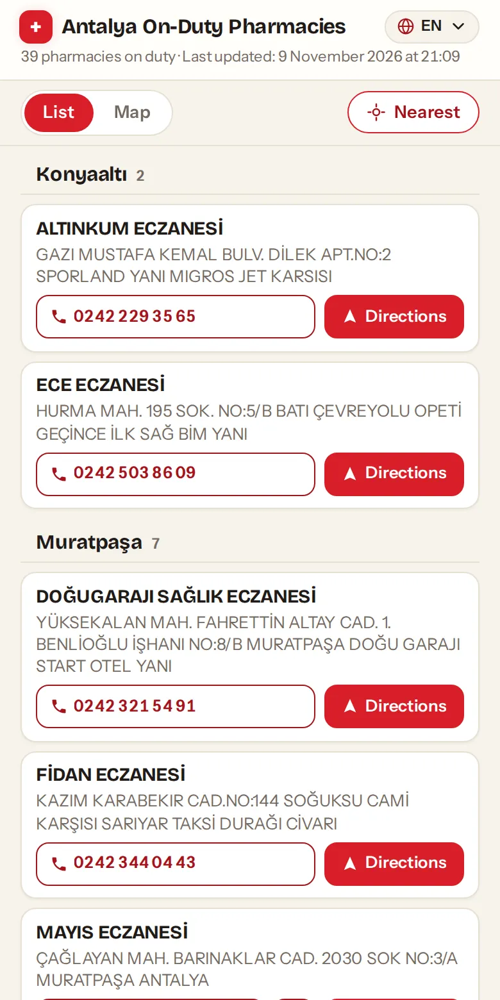
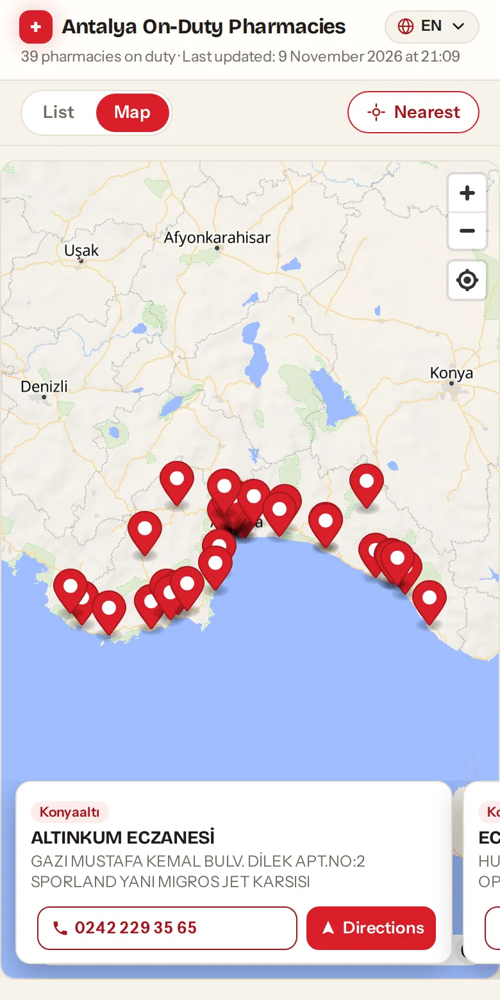

# Nöbetçi Eczane

Find the closest pharmacy open after hours in Antalya. The site lists today's
on-duty (nöbetçi) pharmacies on a map and sorts them by distance from you. The
Antalya Chamber of Pharmacists publishes the same roster as a Turkish-only list
grouped by district. This site adds the map, the distance sort, and English,
Russian and German.

**Live at [eczane.apphane.dev](https://eczane.apphane.dev).**

- **Nearest first.** One tap sorts the province's on-duty pharmacies by
  distance from your location.
- **Map or list.** Pins on a MapLibre map, or a list grouped by district.
- **One-tap actions.** Call, WhatsApp (mobile numbers), or directions in Google
  Maps, Yandex Maps or OpenStreetMap.
- **Four languages.** Turkish, English, Russian, German. Pharmacy names and
  addresses stay as the chamber publishes them.
- **Fresh every morning.** GitHub Actions scrapes the chamber's page at 06:10
  UTC (09:10 in Turkey) and redeploys. Each page shows when its data was
  fetched.
- **No backend.** Static HTML on Cloudflare Pages, with the data baked in at
  build time.
- **Works offline.** Installable as a PWA. With no connection, the service
  worker serves the last loaded list. The map needs a network.

<p>
  
  
</p>

[Run locally](#run-locally) · [How it works](#how-it-works) ·
[Deployment](#deployment) · [Adding a province](#adding-a-province)

---

## Run locally

Requires Node.js 22.12 or newer.

```sh
git clone https://github.com/apphane-dev/eczane.git
cd eczane
npm ci
npm run scrape -- antalya   # writes src/data/antalya.json
npm run dev                 # http://localhost:4321/antalya
```

Skip the scrape and the site still builds, showing a "no data" message.

With [mise](https://mise.jdx.dev), `mise run dev` first runs `npm ci` if
`node_modules` is missing or older than `package-lock.json`.

| Command                    | Action                                              |
| :------------------------- | :-------------------------------------------------- |
| `npm run scrape -- <slug>` | Scrape a province into `src/data/<slug>.json`       |
| `npm run dev`              | Start the dev server                                |
| `npm run build`            | Build the static site into `dist/`                  |
| `npm run preview`          | Serve `dist/` locally                               |

---

## How it works

`scripts/scrape.ts` fetches the chamber's page and parses it with
[cheerio](https://cheerio.js.org/). The page is server-rendered, so no headless
browser is needed. The scraper writes a `CityData` JSON file (shape in
`src/lib/types.ts`), and [Astro](https://astro.build) renders it into static
pages, one per language.

```
scripts/scrape.ts   scraper, one province per run
src/
  data/             scraped JSON, git-ignored
  lib/
    cities.ts       province registry: slug, name, source URL
    types.ts        Pharmacy / CityData shape shared by scraper and UI
    i18n.ts         UI strings for tr, en, ru, de
    pharmacy.ts     phone formatting, call/WhatsApp/directions links
  components/       CityPage, PharmacyCard, MapView
  pages/            antalya.astro, plus en/, ru/, de/ copies
public/             icons, PWA manifest, service worker (sw.js)
```

The selectors come from the Gleam scraper on the `gleam` branch, which reads
the same page with headless Chrome.

---

## Deployment

Two GitHub Actions workflows scrape, build, and deploy `dist/` to the
Cloudflare Pages project `eczane` with `wrangler`:

| Workflow          | Trigger                         |
| :---------------- | :------------------------------ |
| `deploy.yml`      | push to `main`, manual          |
| `update-data.yml` | daily at 06:10 UTC, manual      |

Both share the `prod-deploy` concurrency group, so a push deploy queues behind
a running daily deploy instead of racing it. They need the
`CLOUDFLARE_API_TOKEN` secret and the `CLOUDFLARE_ACCOUNT_ID` repository
variable.

> **Never commit scraped data.** `src/data/*.json` is git-ignored on purpose.
> Rosters change daily, and a committed snapshot ships to production whenever a
> build runs before the scraper.

---

## Adding a province

The scraper handles any province in `src/lib/cities.ts`. The site renders only
Antalya.

1. Add an entry to `src/lib/cities.ts` with a `slug`, a display `name`, and the
   province's on-duty pharmacy page URL.
2. Run `npm run scrape -- <slug>`. It exits with an error if it parses zero
   pharmacies. Then adapt the selectors in `scripts/scrape.ts` (`.ilce`,
   `.ilcebas`, `.nobetciDiv`) to the new page's markup and rerun.
3. Check the scraper's summary line: a plausible pharmacy count, with
   coordinates on most of them.

Showing the province on the site takes UI work. `CityPage.astro` reads
`antalya.json` by name, and these all hard-code Antalya: the page routes,
`cityPath()` and the translated titles in `src/lib/i18n.ts`, and the precache
list in `public/sw.js`. Once the site renders the province, add
`npm run scrape -- <slug>` to both workflows.
